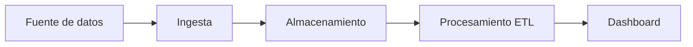
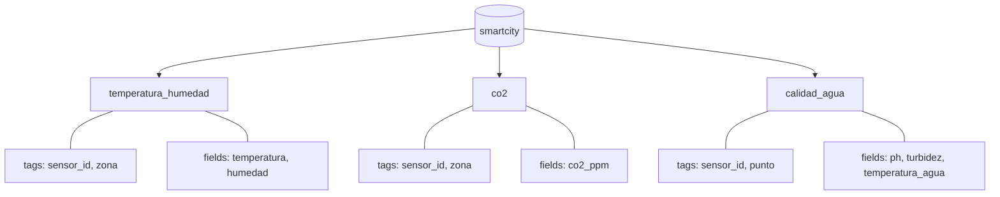
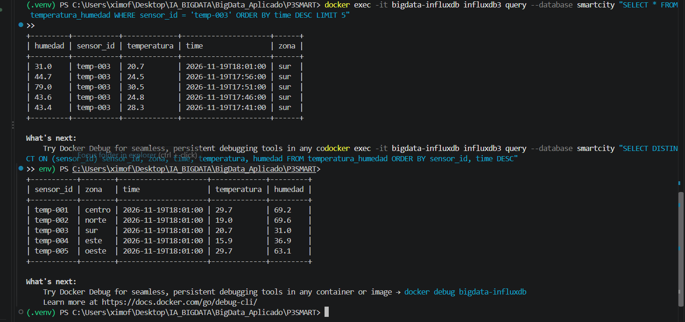
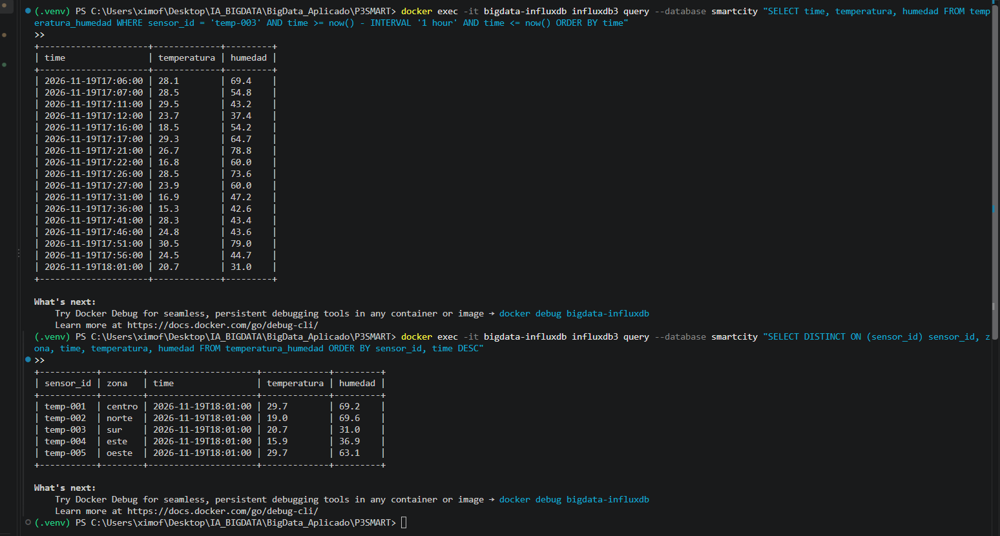
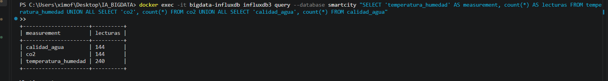

# Proyecto 3: SMART

## Descripción y objetivo

Este proyecto tiene como objetivo desarrollar un flujo de trabajo para la ingesta, el procesamiento y el análisis de los datos asociados al proyecto SMART. La finalidad es preparar los datos para obtener resultados útiles y facilitar su visualización.

## Arquitectura



## Estructura del repositorio

```text
P3SMART/
├── .gitignore
├── README.md
├── ingesta/
├── etl/
└── dashboard/
```

## Tecnologías

- Python 3.10 o superior.
- Git y GitHub.
- Herramientas de procesamiento y análisis de datos.


## Bitácora de prácticas → Bloque 2

### Proceso

```bash
docker compose up -d influxdb
docker exec -it bigdata-influxdb influxdb3 create database smartcity
pip install influxdb3-python
python simulacion/simular_sensores.py
```

El servidor se arranca con `--without-auth` (sin token) para simplificar la práctica; el cliente de Python igualmente pide un token, así que se le pasa uno de relleno. `simular_sensores.py` genera 24 lecturas por sensor (una cada 5 minutos, últimas 2 horas) para 11 sensores y escribe 264 puntos.

### Modelo: 3 measurements

InfluxDB crea los measurements al escribir el primer dato; no hay que crear tablas.



| Measurement | Tags | Fields | Sensores |
|---|---|---|---|
| temperatura_humedad | sensor_id, zona | temperatura (°C), humedad (%) | temp-001 … temp-005 |
| co2 | sensor_id, zona | co2_ppm | co2-001 … co2-003 |
| calidad_agua | sensor_id, punto | ph, turbidez, temperatura_agua | agua-001 … agua-003 |

### Tags vs fields (cardinalidad)

- **Tags** = lo que sirve para **filtrar y agrupar** y tiene **pocos valores distintos**: `sensor_id` (11 sensores), `zona` (5) y `punto` (3). Con pocos valores la cardinalidad es baja y las consultas por sensor o zona son rápidas.
- **Fields** = los **valores medidos**, que cambian en cada lectura (temperatura, humedad, ppm, pH…). Nunca se ponen como tag: cada valor distinto crearía una serie nueva y la cardinalidad se dispararía.
- El **tiempo** (`time`) es la marca de cada lectura; no hace falta guardarlo aparte.
- Se separan en 3 measurements porque cada tipo de sensor mide cosas distintas y tiene su propia ubicación (`zona` en el aire, `punto` en el agua).

### Consultas (verificación)

Se ejecutan con `docker exec -it bigdata-influxdb influxdb3 query --database smartcity "<SQL>"`.

**Q1 — Últimas lecturas de un sensor concreto** (valor "actual" del dashboard)

```sql
SELECT * FROM temperatura_humedad WHERE sensor_id = 'temp-003' ORDER BY time DESC LIMIT 5
```

**Q2 — Evolución de un sensor en un rango de fechas** (gráficas de tendencia)

```sql
SELECT time, temperatura, humedad
FROM temperatura_humedad
WHERE sensor_id = 'temp-003'
  AND time >= now() - INTERVAL '1 hour' AND time <= now()
ORDER BY time
```

Devuelve las lecturas del sensor en la última hora, ordenadas en el tiempo (una cada 5 minutos).

**Q3 — Última lectura de todos los sensores de un tipo** (mapa/resumen general)

```sql
SELECT DISTINCT ON (sensor_id) sensor_id, zona, time, temperatura, humedad
FROM temperatura_humedad
ORDER BY sensor_id, time DESC
```

Resultado de Q3: exactamente 5 filas (temp-001 … temp-005), una por sensor, cada una con su lectura más reciente.

Comprobación de que hay lecturas de los tres tipos de sensor:

```sql
SELECT 'temperatura_humedad' AS measurement, count(*) AS lecturas FROM temperatura_humedad
UNION ALL SELECT 'co2', count(*) FROM co2
UNION ALL SELECT 'calidad_agua', count(*) FROM calidad_agua
```

Resultado: temperatura_humedad 240, co2 144, calidad_agua 144. El simulador se ejecutó dos veces (120 + 72 + 72 = 264 puntos por ejecución); como cada ejecución usa la hora del momento, las lecturas no se pisan sino que se acumulan.

### Evidencias






